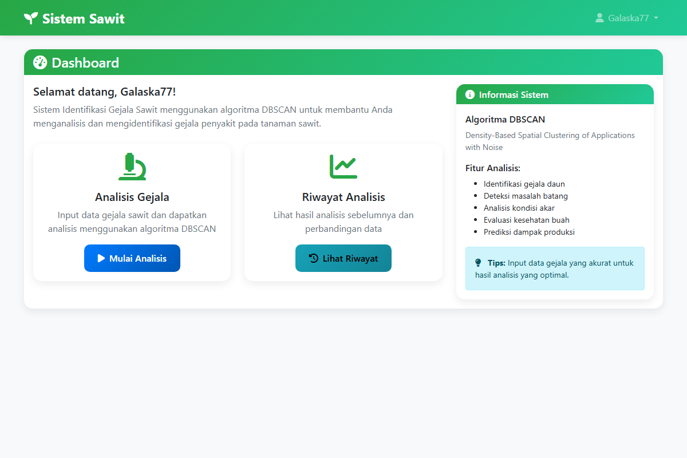
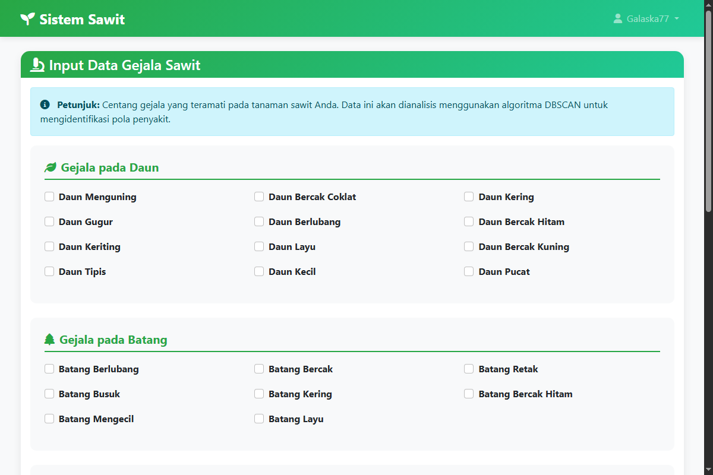
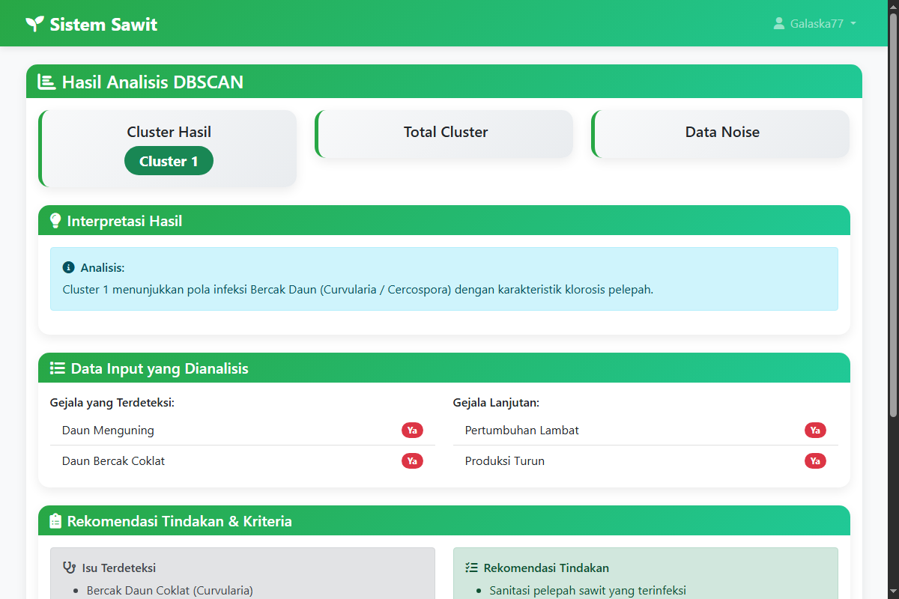
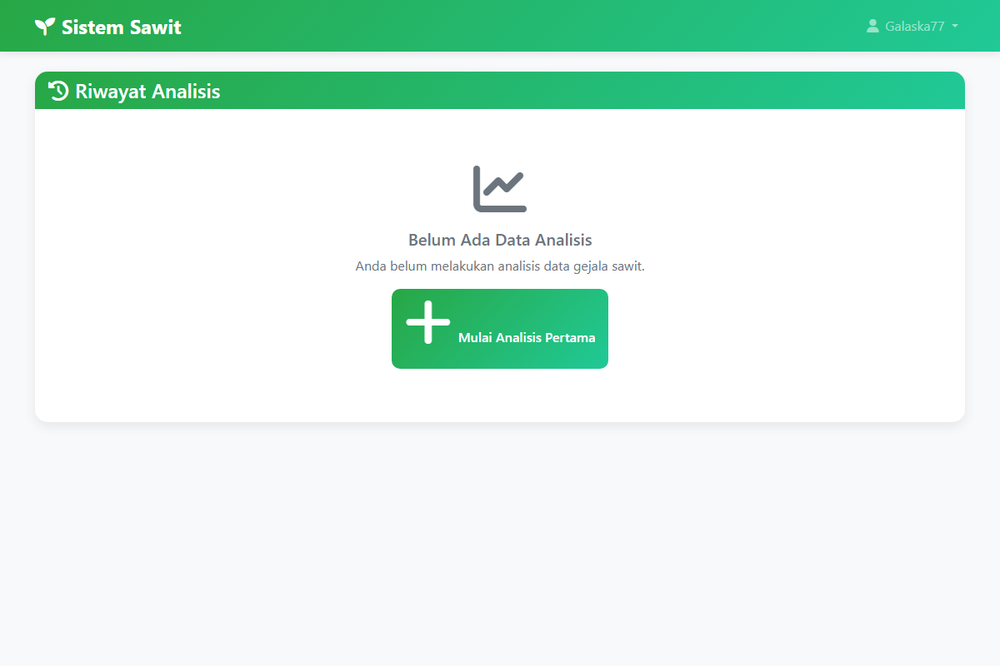
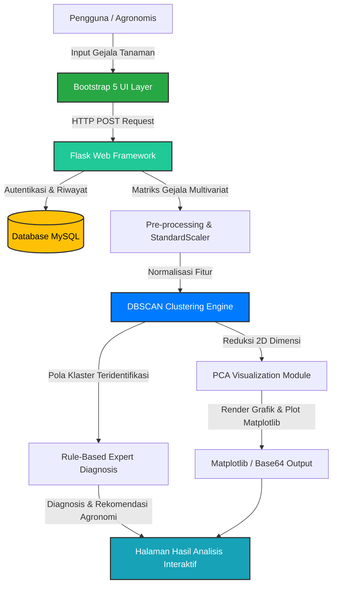

# 🌴 Sawit Detector - Palm Oil Disease Diagnostic & DBSCAN Clustering System

<p align="center">
  
</p>

> **Sistem Cerdas Berbasis Web & Machine Learning (DBSCAN Clustering) untuk Deteksi, Identifikasi, dan Diagnosis Gejala Penyakit Tanaman Kelapa Sawit.**
> 
> *Developed by [Galaska77](https://github.com/Galaska77)*

---

## 🇮🇩 Ringkasan Proyek (Bahasa Indonesia)

**Sawit Detector** adalah aplikasi berbasis web yang dirancang untuk membantu petani, agronomis, dan pengelola perkebunan kelapa sawit dalam mendeteksi dan mengelompokkan gejala penyakit tanaman kelapa sawit (*Elaeis guineensis*) secara dini dan akurat. Menggunakan algoritma unsupervised learning **DBSCAN (Density-Based Spatial Clustering of Applications with Noise)** dipadukan dengan reduksi dimensi **PCA (Principal Component Analysis)**, sistem ini mampu mengenali klaster keparahan dan tipe penyakit kelapa sawit tanpa batasan bentuk klaster serta tangguh terhadap data pencilan (*noise/outliers*).

### 🌟 Fitur Utama
1. **🔬 DBSCAN Clustering Engine:** Mengelompokkan pola penyakit (seperti Bercak Daun Curvularia, Busuk Pangkal Batang Ganoderma, Busuk Pupus, dsb.) secara otomatis berdasarkan karakteristik gejala daun, batang, akar, bunga, dan buah.
2. **📈 Visualisasi Reduksi Dimensi PCA:** Memetakan data multivariat gejala sawit ke dalam bidang 2D interaktif untuk visualisasi kedekatan antar-klaster secara nyata.
3. **📋 Form Diagnosis Multikategori Terpadu:** Antarmuka input data gejala tanaman yang komprehensif (daun menguning, nekrotik, retak batang, busuk akar, hingga dampak laju produksi).
4. **💡 Rekomendasi Solusi & Tindakan Agronomi:** Memberikan rekomendasi penanganan teknis perkebunan langsung berdasarkan hasil klastering gejala yang dialami tanaman.
5. **🗂️ Riwayat Analisis & Rekam Medis Tanaman:** Pencatatan setiap sesi diagnosis ke dalam database relasional MySQL untuk pemantauan kesehatan kebun sawit secara berkala.
6. **🔐 Autentikasi & Multi-Pengguna Aman:** Sistem login dan registrasi berbasis hashing sandi yang terenkripsi dan aman.

---

## 🇬🇧 Project Overview (English)

**Sawit Detector** is a web-based diagnostic application engineered to assist palm oil planters, agronomists, and estate managers in detecting and grouping oil palm crop symptoms early and accurately. Leveraging the **DBSCAN (Density-Based Spatial Clustering of Applications with Noise)** unsupervised learning algorithm combined with **PCA (Principal Component Analysis)** dimensionality reduction, the system identifies disease clusters and severity patterns while remaining robust against noise and outliers.

### 🌟 Core Features
1. **🔬 DBSCAN Clustering Engine:** Automatically clusters palm oil crop diseases (such as Curvularia leaf spot, Ganoderma stem rot, Spear rot, etc.) according to symptoms observed on leaves, trunks, roots, flowers, and fruits.
2. **📈 PCA Dimensionality Visualization:** Maps multidimensional symptom matrices into intuitive 2D scatter plots showing real-time cluster proximities.
3. **📋 Comprehensive Symptom Input:** An intuitive interface capturing granular plant anomalies including chlorosis, leaf spots, trunk cracks, root rot, and yield drops.
4. **💡 Actionable Agronomic Recommendations:** Supplies practical estate management and treatment protocols tailored to the detected cluster.
5. **🗂️ Diagnosis History & Plant Health Logging:** Archives historical diagnostic evaluations in a relational database for continuous plantation surveillance.
6. **🔐 Secure Authentication:** Multi-user registration and login with encrypted password hashing.

---

## 📸 Screenshots (Tampilan Aplikasi)

| Dashboard Utama | Form Input Gejala Sawit | Hasil Analisis & Clustering | Riwayat Diagnosa Kebun |
| :---: | :---: | :---: | :---: |
|  |  |  |  |

---

## 🛠️ Tech Stack & Architecture (Teknologi & Arsitektur)



*   **UI Framework:** HTML5, CSS3, JavaScript, Bootstrap 5, FontAwesome Icons
*   **Web Framework:** Python Flask (Routing, Session Management, Template Engine Jinja2)
*   **Data Mining & Machine Learning:** scikit-learn (DBSCAN Clustering, PCA Decomposition, StandardScaler)
*   **Scientific Computing:** NumPy, Pandas
*   **Visualization Engine:** Matplotlib, Seaborn
*   **Database:** MySQL (Relational Schema: `users`, `analysis_results`)
*   **Security:** Werkzeug Password Security (pbkdf2:sha256)

---

## 🚀 Download & Installation (Panduan Instalasi)

### 📥 Direct Installation / Siap Pakai (Instalasi Langsung)
Bagi pengguna umum atau praktisi kebun yang ingin langsung mencoba aplikasi tanpa perlu mengompilasi kode dari awal:
1. Buka halaman [GitHub Releases](https://github.com/Galaska77/Aplikasi-Detector-Penyakit-sakit/releases) repositori ini.
2. Unduh file **`sawit-detector-v1.0.0.zip`** versi terbaru.
3. Ekstrak file zip ke komputer Anda.
4. Jalankan **`start.bat`** (Windows) atau **`start.sh`** (Linux/macOS) untuk otomatis memeriksa dependencies dan menyalakan server lokal.
5. Akses sistem di browser Anda: `http://localhost:5000`.

---

### 💻 Manual Setup (Panduan Pengembang / Developer)

#### 1. Clone Repositori
```bash
git clone https://github.com/Galaska77/Aplikasi-Detector-Penyakit-sakit.git
cd Aplikasi-Detector-Penyakit-sakit
```

#### 2. Buat & Aktifkan Virtual Environment (Opsional tapi disarankan)
```bash
# Windows
python -m venv venv
venv\Scripts\activate

# Linux / macOS
python3 -m venv venv
source venv/bin/activate
```

#### 3. Instalasi Dependencies
```bash
pip install -r requirements.txt
```

#### 4. Konfigurasi Database MySQL
1. Pastikan layanan MySQL Anda (seperti XAMPP / Laragon / MySQL Service) sudah aktif.
2. Import schema database:
```bash
mysql -u root -p < database.sql
```
*(Atau jalankan skrip otomatisasi database bawaan)*:
```bash
python setup_database.py
```
3. Sesuaikan konfigurasi koneksi di file `config.txt` atau `app.py`:
```python
app.config['MYSQL_HOST'] = 'localhost'
app.config['MYSQL_USER'] = 'root'
app.config['MYSQL_PASSWORD'] = '' # Sesuaikan password mysql Anda jika ada
app.config['MYSQL_DB'] = 'sawit_dbscan'
```

#### 5. Menjalankan Aplikasi
```bash
python app.py
```
Buka browser dan kunjungi: **`http://localhost:5000`**

*Akun Demo Pengujian:*
*   **Username:** `admin` | **Password:** `admin`
*   **Username:** `test` | **Password:** `test`

---

## 📊 Detail Algoritma & Parameter DBSCAN

Algoritma **DBSCAN** mengelompokkan data berdasarkan kepadatan titik data dalam ruang fitur:
*   **$\varepsilon$ (Epsilon / `eps` = 0.5):** Radius jarak maksimum antara dua observasi untuk diakui berada dalam lingkungan tetangga yang sama.
*   **`min_samples` (= 3):** Jumlah minimum sampel titik dalam radius $\varepsilon$ untuk membentuk titik inti (*core point*).
*   **Outlier Detection (`Cluster -1`):** Observasi yang tidak memenuhi batas kepadatan secara otomatis diklasifikasikan sebagai noise, sangat berguna untuk mendeteksi anomali gejala langka pada tanaman sawit.

---

## 📁 Struktur Direktori Repositori

```text
├── assets/
│   ├── logo/
│   │   └── logo.png             # Logo resmi aplikasi
│   └── screenshots/
│       ├── dashboard.png        # Tampilan dashboard utama
│       ├── input_data.png       # Tampilan form input gejala
│       ├── results.png          # Tampilan hasil analisis & clustering
│       └── history.png          # Tampilan riwayat diagnosis
├── templates/
│   ├── dashboard.html           # Template tampilan dashboard
│   ├── history.html             # Template tampilan histori
│   ├── input_data.html          # Template input gejala
│   ├── login.html               # Template halaman login
│   ├── register.html            # Template registrasi akun
│   └── results.html             # Template tampilan hasil diagnosa
├── app.py                       # Aplikasi web utama (Flask)
├── app_final.py                 # Versi aplikasi dengan 48 gejala lengkap
├── palm_oil_analyzer.py         # Engine mandiri simulasi & clustering ML
├── database.sql                 # Schema tabel MySQL
├── requirements.txt             # Daftar dependensi Python
├── setup_database.py            # Skrip otomatisasi inisialisasi DB
├── start.bat                    # Runner otomatis Windows
├── start.sh                     # Runner otomatis Linux/Mac
├── LICENSE                      # Lisensi resmi MIT
└── README.md                    # Dokumentasi lengkap repositori
```

---

## 🛡️ License & Developed By

*   **Developer:** [Galaska77](https://github.com/Galaska77)
*   **License:** [MIT License](LICENSE) - Proyek ini dirilis dan dilisensikan secara terbuka di bawah Lisensi MIT.
